<p align="center">
  <a href="https://saifriaz.tech"></a>
</p>

<p align="center">
  <a href="https://saifriaz.tech"></a>
</p>

<p align="center">
  <a href="https://saifriaz.tech"></a>
  <a href="https://www.linkedin.com/in/saif-riaz-"></a>
  <a href="mailto:saifriaz1234@gmail.com"></a>
  
</p>

---

### 👋 About me

```yaml
name:      Saif Riaz
role:      DevOps & Site Reliability Engineer @ Aslase Pvt. Ltd.
location:  Lahore, Pakistan — working remotely with teams worldwide
education: BS Computer Science, Information Technology University (ITU) — 2026
clouds:    [Microsoft Azure, AWS]
focus:     [uptime, zero-trust security, CI/CD, observability, FinOps]
open_to:   [full-time, contract, remote, relocation]
```

- ☁️ Built my company's cloud platform **from scratch** on a **$50,000 Microsoft Azure startup grant**
- 🏢 Run the infrastructure behind **Takafo** (HR platform for **Mubadala, UAE**), **humentra.ai** and a family of AI products
- 🚀 Cut release time from **hours to under 10 minutes** and the monthly cloud bill by **33%**
- 🔁 Migrated a production platform **AWS → Azure** with **zero data loss** (and 22% cheaper)
- 🔐 Built a **zero-trust just-in-time access broker** — short-lived /32 firewall rules instead of open SSH ports
- 📈 Rolled out company-wide **Prometheus · Loki · Grafana** monitoring with alerts to Microsoft Teams — **99.9% uptime**
- 🏸 Off the keyboard: squash and swimming

---

### 🛠️ DevOps toolbox

**Cloud & edge**<br>


**Containers, IaC & CI/CD**<br>

&nbsp;
&nbsp;


**Monitoring & security**<br>

&nbsp;
&nbsp;


**Code & data**<br>


---

### 🔁 How I ship

```text
  Plan ──▶ Code ──▶ Build ──▶ Test ──▶ Secure ──▶ Release ──▶ Deploy ──▶ Operate ──▶ Monitor ─┐
  (Jira)  (Git)   (Docker) (PyTest)  (ZAP·Trivy) (GH Actions) (K8s·TF)  (Azure·AWS) (Grafana) │
   ▲                                                                                        │
   └──────────────────────────── feedback loop: what we learn goes back into planning ──────┘
```

---

### 🚀 Featured projects

| Project | What it does | Stack |
|---|---|---|
| **Zero-trust JIT access broker** · _production_ | Opens single-IP firewall access for 1–8 h after Entra ID sign-in, then closes it — no more static jump hosts | TypeScript · Azure NSG · Entra ID |
| **LGTM observability stack** · _production_ | Metrics, logs and uptime probes for every service, RED/USE alerts to Microsoft Teams | Prometheus · Loki · Grafana · Alloy |
| **Takafo for Mubadala (UAE)** · _production_ | Hardened Azure estate: Front Door WAF, App Gateway, private subnets, HA PostgreSQL | Azure · PostgreSQL · Key Vault |
| [**TIXE**](https://github.com/SaifRiaz3256/Tixe-app-azure) · _capstone, Grade A_ | AI freelancing marketplace with escrow payments and a RAG support bot | React · Node.js · Stripe · AWS + Azure · OWASP ZAP |
| [**IBM DevOps capstone**](https://github.com/SaifRiaz3256/devops-capstone-project) | Microservice with 95%+ test coverage shipped by Tekton to OpenShift | Python · Docker · Tekton · OpenShift |
| [**Secure Azure IaC**](https://github.com/SaifRiaz3256/orzeh-assessment) | Full Azure network & compute in Terraform with locked remote state | Terraform · OpenTofu · Azure |
| [**saifriaz.tech**](https://github.com/SaifRiaz3256/saifriaz.tech) | My portfolio — static, fast, light/dark, structured data for SEO | HTML · CSS · JS · GitHub Pages |

👉 **All 37 projects with stack icons:** [saifriaz.tech/#projects](https://saifriaz.tech/#projects)

---

### 🎓 Certifications


---

### 📊 GitHub stats

<p align="center">
  
</p>
<p align="center">
  
  
</p>
<p align="center">
  
</p>

<p align="center"><sub>⚡ Always happy to talk cloud, reliability and security — <a href="https://saifriaz.tech/#contact">get in touch</a>.</sub></p>
